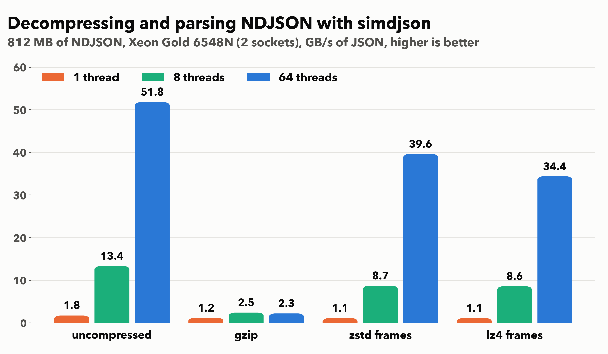

# Parsing compressed JSON at 40 GB/s

A common way to store JSON data is to write one document per line. We call it NDJSON or JSON Lines. Log files, database exports and machine-learning datasets often come in this format. The files can be large, so we may compress them.

```json
{"id":1,"active":true,"user":{"name":"user_1","tags":["guest"]},"score":-3862,"note":"..."}
{"id":2,"active":false,"user":{"name":"user_2","tags":["staff","admin"]},"score":8123,"note":"..."}
```

How fast can you read such a file? I wrote a small demo with [simdjson](https://github.com/simdjson/simdjson). My test file has 5 million records: 812 MB of NDJSON. For each record, I read a few fields. I count the active records, and I sum the scores of the active records whose user has the `admin` tag.

You could decompress the whole file, but it might be better to process the compressed file. So you decompress a chunk, you parse the complete lines in that chunk, and you move the incomplete last line to the front of the buffer. In NDJSON, a newline can never appear inside a document: a newline in a string must be escaped as `\n`. So you can always cut the buffer right after its last newline character. The simdjson library has a function for many documents in one buffer (`iterate_many`):

```cpp
simdjson::ondemand::parser parser;
while (true) {
  // fill the buffer with decompressed bytes...
  size_t cut = eof ? len : last_newline(buf, len) + 1;
  simdjson::ondemand::document_stream stream;
  parser.iterate_many(buf, cut, cut).get(stream);
  for (auto doc : stream) {
    accumulate(doc.value_unsafe(), result);
  }
  if (eof) { break; }
  std::memmove(buf, buf + cut, len - cut);
  len -= cut;
}
```

I ran my benchmarks on an Intel Xeon Gold 6548N server (Emerald Rapids) with two sockets, 64 cores and 128 threads. I use GCC 14.

A gzip file is one long compressed stream. The decompressor needs the previous 32 KiB of output to decode what comes next. So you must decompress the file from the start, with one thread. I can still parse in other threads: one thread decompresses chunks and puts them in a queue, and the other threads parse them. It doubles the speed to 2.5 GB/s.

Other formats do better. A zstd or an lz4 file can be made of many independent *frames*, one after the other. It is still a regular `.zst` or `.lz4` file: the usual command-line tools decompress it as usual.

My program writes a new frame every 256 KiB of JSON, always after a newline. Each frame stores its decompressed size and a checksum. To find where a frame ends, you only need to read a few block headers. You do not need to decompress anything. So the threads can take frames one by one, and each thread decompresses and parses its own frames.



With one thread, zstd and lz4 are no faster than gzip: about 1.1 GB/s. With 64 threads, I get 40 GB/s with zstd and 34 GB/s with lz4. That is 16 times faster than the best I can do with gzip.

The files are not much larger. Small frames compress a bit worse, since each frame starts from scratch, but the zstd file is only 6% larger than the gzip file.

| file | size |
|---|---:|
| NDJSON | 812.0 MB |
| gzip (one stream) | 56.9 MB |
| zstd (256 KiB frames) | 60.6 MB |
| lz4 (256 KiB frames) | 108.5 MB |

My data is synthetic. The records are very repetitive, which makes decompression fast. Your data might decompress more slowly.

If you control how your JSON files are written, consider using zstd with many frames. You get files about as small as with gzip, and you can read them many times faster with multiple threads.

**Source code**: [https://github.com/simdjson/simdjson_compressed_demo](https://github.com/simdjson/simdjson_compressed_demo). The benchmark numbers and the plotting script are in [my blog repository](https://github.com/lemire/Code-used-on-Daniel-Lemire-s-blog/tree/master/2026/09/jsonstream).
