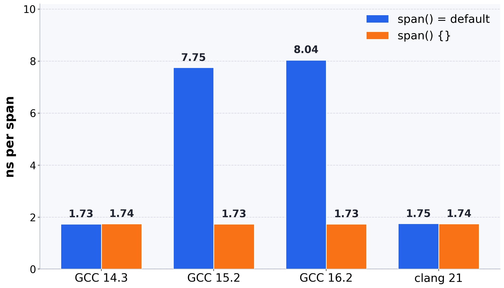

# In C++, `= default` and `{}` are not the same constructor

You can write an empty default constructor as `span() = default` or as `span() {}`. It can have remarkable effects on performance.

```cpp
struct span {
  const char *p;
  int len;
  const char *end;
  span() = default; // or span() {}
  span(const char *s, int n) : p(s), len(n), end(s + n) {}
};
```

`span() = default` on its first declaration makes `span` trivial. `span() {}` is user-provided, so `span` is not trivial.

| Constructor | Declaration | What happens | Members |
|---|---|---|---|
| `span() = default` | `span s;` | nothing | uninitialized |
| `span() = default` | `span s{}` | the whole object is zeroed, padding included; the constructor does not run | zero |
| `span() {}` | `span s;` | the empty constructor is called; the compiler can delete the call | uninitialized |
| `span() {}` | `span s{}` | the empty constructor is called; the object is not zeroed | uninitialized |

Default the constructor out of line, `span::span() = default`, and it is user-provided too: same as the `span() {}` rows.

## An example

This `span` is a start pointer, a length, and an end pointer. A `box` holds one span. The expression `box()` value-initializes that span. The loop assigns a value-initialized box when `i` reaches `n`, and otherwise a span of length `i + 1`:

```cpp
struct box {
  span s;
  box() : s() {}
  box(span in) : s(in) {}
};

void consume(box &);

void walk(const char *s, int n) {
  for (int i = 0;; i++) {
    box b;
    b = i == n ? box() : box(span(s, i + 1));
    if (i == n) { return; }
    consume(b);
  }
}
```

The `box()` path runs once, as the loop exits, and that span is not passed to `consume`.

With `span() {}`, GCC 16 (`-O2 -march=x86-64`) writes the three fields directly where `consume` expects them:

```asm
.L4:
	mov	eax, ebx
	mov	QWORD PTR [rsp+16], rbx
	mov	rdi, rsp
	add	rbx, 1
	sub	eax, ebp
	mov	QWORD PTR [rsp], rbp
	mov	DWORD PTR [rsp+8], eax
	call	consume(box&)
	cmp	rbx, r12
	jne	.L4
```

With `span() = default`, GCC 16 stores the end pointer, `rbx`, straight into the box. The start pointer and the length go through a temporary, and the first 16 bytes of that temporary are copied back. 


```asm
.L3:
	mov	eax, ebx
	mov	QWORD PTR [rsp+32], rbp
	mov	rdi, rsp
	sub	eax, ebp
	mov	QWORD PTR [rsp+16], rbx
	add	rbx, 1
	mov	DWORD PTR [rsp+40], eax
	movdqa	xmm0, XMMWORD PTR [rsp+32]
	movaps	XMMWORD PTR [rsp], xmm0
	call	consume(box&)
	cmp	rbx, r12
	jne	.L3
```


I time the best of five runs of 100 million spans, on one core of an Intel Xeon Gold 6548N (Emerald Rapids), with `-O2 -march=x86-64`. [My code is available](https://github.com/lemire/Code-used-on-Daniel-Lemire-s-blog/tree/master/2026/10/cppinit).

| compiler | `span() = default` | `span() {}` |
|---|---|---|
| GCC 14.3 | 1.73 ns/span | 1.74 ns/span |
| GCC 15.2 | 7.75 ns/span | 1.73 ns/span |
| GCC 16.2 | 8.04 ns/span | 1.73 ns/span |
| clang 21 | 1.75 ns/span | 1.74 ns/span |



With GCC 15 and GCC 16, the `= default` version is over four times slower.
