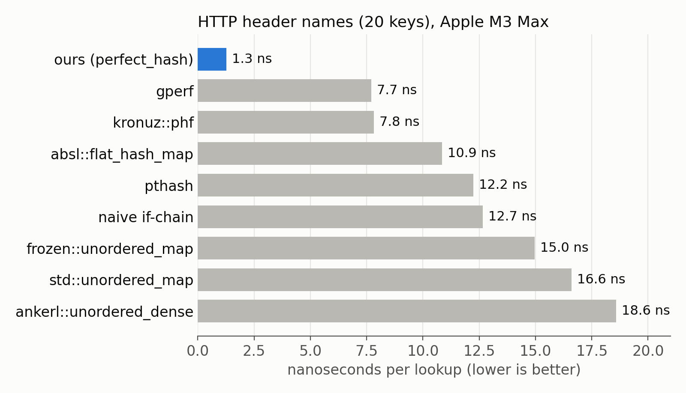
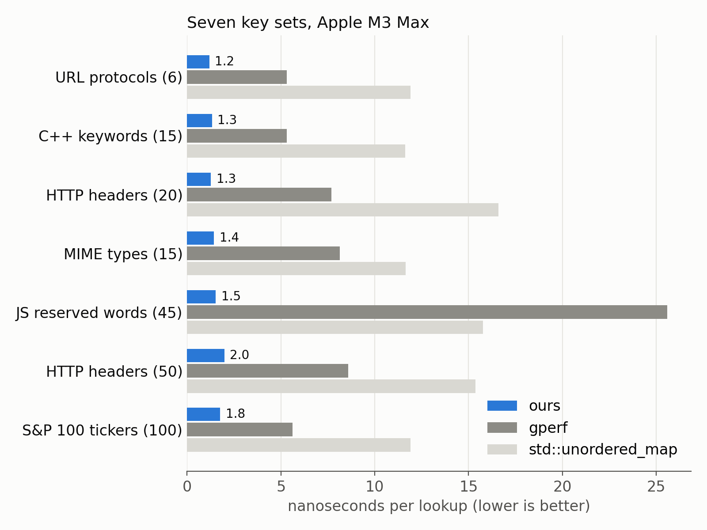
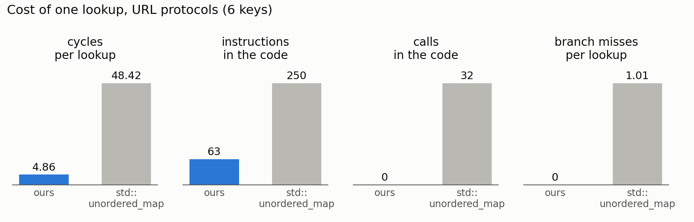

# Billion-query-per-second lookup tables in C++

A lot of software spends its time mapping strings to values. A web server must identify the HTTP method (`GET`, `POST`, ...). It must recognize header names. A URL parser must recognize the protocol (`http`, `https`, `ftp`, ...). A compiler must recognize keywords.

In C++, the default approach is to put the strings in a `std::unordered_map`.

```cpp
std::unordered_map<std::string_view, Method> methods = {
    {"GET", Method::GET}, {"POST", Method::POST}, {"PUT", Method::PUT},
    {"DELETE", Method::DELETE}, {"PATCH", Method::PATCH}};
```

It works. But notice something: the keys are known when you write the code. They never change. And yet we pay at runtime as if they could change at any time: we hash the whole string, we pick a bucket, we follow a pointer, we compare, maybe we walk a list.

## Perfect hashing

A hash function maps keys to slots. When two keys land in the same slot, we have a collision, and we must deal with it. Collisions are what make hash tables complicated and slow.

If you know all of your keys ahead of time, you can construct a hash function designed for your keys, a function that never produces a collision. It is called a perfect hash function. The idea is old: the GNU `gperf` tool has been doing it since 1989. You give it a list of keywords, and it generates C code.

We follow the same design as `gperf`. The slot for a key is computed as follows.

```
slot = (length + asso[key[i]] + asso[key[j]] + ...) % table_size
```

We add the length of the key to a few small values taken from an association table (`asso`) indexed by the characters at a few selected positions. Usually, one or two positions are enough. The table size is a power of two, so the modulo is a single bitwise AND.

Consider the four HTTP methods `GET`, `PUT`, `POST` and `DELETE`. We use only the first character. Set `asso['G'] = 0`, `asso['P'] = 1` and `asso['D'] = 0`. Then `GET` goes in slot 3 + 0 = 3, `PUT` goes in slot 3 + 1 = 4, `POST` goes in slot 4 + 1 = 5 and `DELETE` goes in slot 6 + 0 = 6. No collision.

To look up `PUT`, we compute the slot (4), and we compare `PUT` with the one key stored in slot 4. One hash, one comparison. If you look up `PATCH`, which is not in the set, you land in slot 5 + 1 = 6, you compare with `DELETE`, and you are done: not found. There is no probing, no chain to walk.

How do we find the association values? We sort the characters by how many keys they touch. We then take them one at a time and try 0, 1, 2, ... until we find a value that does not cause a collision. We never revise a value once it is set. It is a greedy algorithm with bounded work. The bound matters because we do all of this at compile time, and C++ compilers limit how much work a `constexpr` function may do.

## Doing it in C++

With [our library](https://github.com/ConstexprCore/perfect_hash), you write ordinary C++23. There is no external tool to run.

```cpp
#include <ConstexprCore/perfect_hash.h>

using namespace ConstexprCore;

enum class Method { GET, POST, PUT, DELETE, PATCH };

constexpr auto methods = make_perfect_map<
    kv<"GET",    Method::GET>,
    kv<"POST",   Method::POST>,
    kv<"PUT",    Method::PUT>,
    kv<"DELETE", Method::DELETE>,
    kv<"PATCH",  Method::PATCH>
>();
```

The map is a compile-time constant. The compiler searches for the perfect hash function when it compiles your code. At runtime, computing the hash can take as few as four instructions: load one byte of the key, load one byte from the association table, add the length, apply a mask.

## Comparing strings quickly

Computing the hash is cheap. But we still need to check that the string we are looking up matches the key stored in the slot. And comparing strings can be expensive: the textbook approach is a loop over the bytes with a branch for each byte. You can easily end up with dozens of instructions and several branches, and the branches are hard to predict when the strings vary.

Instead, we treat the key as a vector. Our processors, whether ARM or x64, have 16-byte registers. So we load 16 bytes unconditionally, even if the key is only three bytes long. We then use a shuffle instruction (`tbl` on ARM NEON) to zero the bytes past the end of the key. The stored keys are zero-padded at compile time. A single vector comparison handles the whole key. We go from about forty instructions and eight branches to five instructions and no branch.

But wait: is it safe to read 16 bytes when you only have three? Reading past the end of a buffer is fine as long as you do not cross into another memory page, and pages are at least 4 kilobytes. So we check whether the address is within 16 bytes of the end of its page. If it is, we take a slower path. Otherwise, we do the wide load. We traded several unpredictable branches for a single branch that is almost always taken the same way.

## How fast is it?

I ran the benchmarks on an Apple M3 Max with AppleClang 15. We look up the keys in random order and we report the time per lookup. Let us first consider the 20 standard HTTP header names.



We need about 1.3 ns per lookup, or about 5 cycles. The classic `gperf` needs 7.7 ns. Abseil's `flat_hash_map`, an excellent hash table, needs 10.9 ns. And `std::unordered_map` needs 16.6 ns. We are thirteen times faster than the standard library.

It is not one lucky key set. Here are the results over several sets of keys, from 6 URL protocols to the 100 tickers of the S&P 100.



We stay between 1.2 ns and 2 ns per lookup. We are 3 to 6 times faster than `gperf`, and 7 to 13 times faster than `std::unordered_map`. Notice how `gperf` struggles with the JavaScript reserved words: there we are 17 times faster.

Why is `std::unordered_map` so much slower? The C++ standard essentially requires a chained hash table. A lookup hashes the whole string by calling a function, follows a pointer to a heap-allocated node and walks a list. Our lookup does a few loads and has no function call. The processor can retire over 8.6 instructions per cycle with our code, which is about as good as it gets on this chip, and it almost never mispredicts a branch.



What about the title? A lookup in 1 ns means a billion lookups per second, on a single core. On the M3 Max, we get between 0.5 and 0.84 billion lookups per second on the realistic key sets. On an Apple M4, with the URL protocols, we exceed one billion lookups per second.


## Conclusion

If your keys are known at compile time, you should not pay for collision handling at runtime. A perfect hash function gets you down to one comparison. With some care, a lookup costs about five cycles. The library is a single header you can drop in your project: [github.com/ConstexprCore/perfect_hash](https://github.com/ConstexprCore/perfect_hash).

This is joint work with Francisco Geiman Thiesen (Microsoft). We presented it at P99 CONF 2026. You can [watch the talk on YouTube](https://www.youtube.com/watch?v=_LG7ZeS5j5A).

The [benchmark numbers and the plotting script](https://github.com/lemire/Code-used-on-Daniel-Lemire-s-blog/tree/master/2026/10/perfect_hash) are available.
