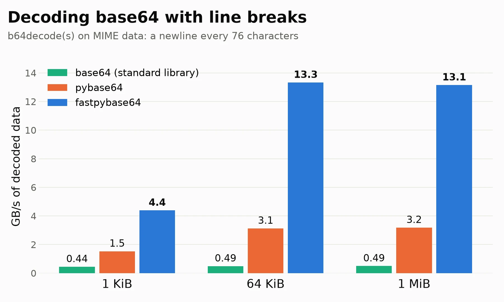

# Decoding base64 in Python at 10 gigabytes per second

We sometimes need to convert binary data to text. For example, your emails
must be stored as text files. Naïvely, you could just use a string of `0` and
`1`, but it would mean using one character per bit. We can do better by
using 64 ASCII characters: all letters, all numbers, plus a few extra characters.
Base64 represents three bytes with four ASCII characters.

Base64 is how email carries attachments, how certificates
are stored, how images get embedded in web pages (data URLs), and
how binary data is encoded inside JSON.

Python comes with a `base64` module. It is written in C, but it processes
the data one character at a time. There is a popular alternative,
[pybase64](https://github.com/mayeut/pybase64).

We have been working on base64 for years. With Wojciech Muła, we showed how to
encode and decode base64 with SIMD instructions. More recently, I worked on
*forgiving* base64 decoding: the variant used by web browsers, which skips
spaces and line breaks. Our [simdutf](https://github.com/simdutf/simdutf)
library implements these ideas. Mainstream browsers rely on it.

But simdutf had no Python binding. So we wrote one:
[fastpybase64](https://github.com/simdutf/fastpybase64).

```sh
pip install fastpybase64
```

```python
import fastpybase64 as base64

base64.b64encode(b"hello")      # b'aGVsbG8='
base64.b64decode("aGVsbG8=")    # b'hello'
```

It is meant as a drop-in replacement for the standard `base64` module. 


How fast is it? I use an Intel Xeon Gold 6548N (Emerald Rapids) pinned to one
core, with Python 3.14.6. I installed fastpybase64 0.1.0 and pybase64 1.5.1
from PyPI. I decode the base64 encoding of random bytes, and I report the
speed in gigabytes of decoded data per second.
A lot of real base64 has line breaks. MIME,
the format of email attachments, breaks the base64 text into lines of 76
characters. So that's what I use as an example. We use a single thread.



| size | base64 | pybase64 | fastpybase64 |
|---:|---:|---:|---:|
| 1 KiB | 0.44 | 1.5 | 4.4 |
| 64 KiB | 0.49 | 3.1 | 13.3 |
| 1 MiB | 0.49 | 3.2 | 13.1 |

The fastpybase64 module is four times faster than pybase64 and 27 times faster than the
standard library. 

The fastpybase64 module is available on [PyPI](https://pypi.org/project/fastpybase64/)
for Linux, macOS and Windows, for Python 3.10 to 3.14, including
free-threaded Python 3.14. My
[benchmark is available](https://github.com/lemire/Code-used-on-Daniel-Lemire-s-blog/tree/master/2026/10/pybase64).

**Further reading**

* Daniel Lemire, [Fast Forgiving Base64 Decoding with SIMD Instructions](https://dl.acm.org/doi/10.1145/3859286), ACM Transactions on Architecture and Code Optimization, 2026.
* Wojciech Muła, Daniel Lemire, [Base64 encoding and decoding at almost the speed of a memory copy](https://arxiv.org/abs/1910.05109), Software: Practice and Experience 50 (2), 2020.
* Wojciech Muła, Daniel Lemire, [Faster Base64 Encoding and Decoding using AVX2 Instructions](https://arxiv.org/abs/1704.00605), ACM Transactions on the Web 12 (3), 2018.
