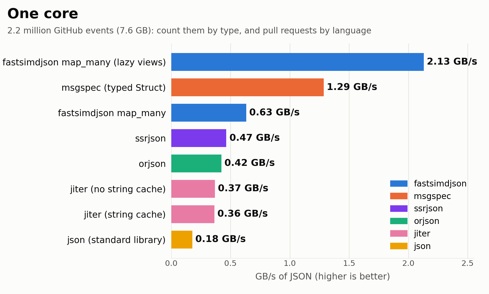
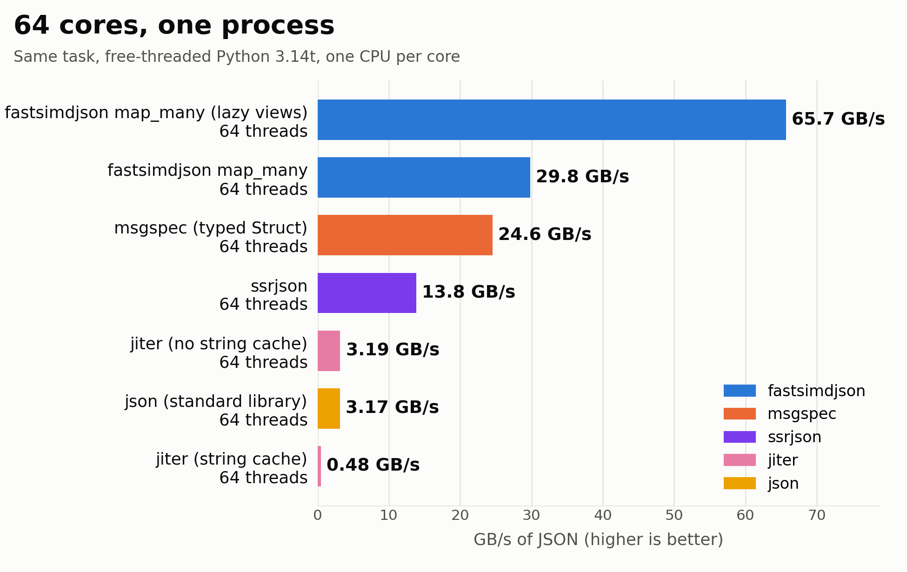

# Parsing JSON at tens of gigabytes per second... in Python

Python used to have limited parallelism, due to its global interpreter lock
(GIL). Only one thread could run Python code at a time. Python 3.14 comes in a
free-threaded version (`python3.14t`), without the global interpreter lock.
Several threads can now run Python code at the same time. 

Let us pick a realistic problem. GitHub publishes everything that happens on
its public repositories: pushes, issues, pull requests, stars, and so forth.
The [GH Archive](https://www.gharchive.org/) project collects these events
as JSON, one event per line (NDJSON), one file per hour. I took eight hours of
March 13, 2024: 7.6 GB of JSON once decompressed, 2.2 million events. I want
to know which programming languages get the most new pull requests. So I
count the events by type, and for each pull request that was opened, I look
up the language of the repository. Each event is a large JSON
object, about 3.4 kB on average: I need only a few of its fields.

The answer, for these eight hours: 65,269 pull requests were opened, mostly
toward TypeScript (11,565), JavaScript (7,778), Python (7,057) and Java
(4,668) repositories. About 5,857 targeted repositories without a language.

With [fastsimdjson](https://github.com/simdjson/fastpysimdjson), our Python
binding for simdjson, the code looks as follows. The function `map_many`
calls my function on each event, using as many threads as I ask for.

```python
import collections, threading
import fastsimdjson

local = threading.local()
parts = []

def one_event(e):
    acc = getattr(local, "acc", None)
    if acc is None:  # first event seen by this thread
        acc = local.acc = (collections.Counter(), collections.Counter())
        parts.append(acc)
    t = e["type"]
    acc[0][t] += 1
    if t == "PullRequestEvent":
        p = e["payload"]
        if p["action"] == "opened":
            acc[1][p["pull_request"]["base"]["repo"]["language"]] += 1

data = open("events.json", "rb").read()
fastsimdjson.map_many(one_event, data, format="lines", threads=64, lazy=True)

types, languages = collections.Counter(), collections.Counter()
for t, lang in parts:
    types.update(t)
    languages.update(lang)
```

Each thread keeps its own counters. The first event a thread sees creates
the pair and appends it to `parts`. Later events on that thread update the
same pair. Nothing in the counters is shared, so the threads do not wait
for each other. `map_many` returns only once every event has been counted.
The main thread then walks `parts`, one pair per thread, and
`Counter.update` adds the counts. A few dozen event types and about a
hundred languages: the merge is tiny next to the parsing.

With `lazy=True`, my function receives a lazy view of the event instead of a
dictionary: the event is parsed, but Python objects are created
only for the values I access. The lazy approach was first developed by
[Tyler Kennedy](https://github.com/TkTech) in another simdjson binding,
[pysimdjson](https://github.com/TkTech/pysimdjson).

How does it compare? I tried the usual suspects: the standard library
(`json`), [orjson](https://github.com/ijl/orjson) and
[msgspec](https://github.com/jcrist/msgspec). msgspec deserves special
mention: it can decode JSON into typed structures that declare only the fields
you need, skipping the rest. It is a lot like our lazy views, except that you
must declare a schema beforehand. I gave msgspec this advantage. In each case,
I verify that we get exactly the same counts.

I use a server with two Intel Xeon Gold 6548N processors (64 cores),
Python 3.14.6, and the current versions of the libraries (fastsimdjson 0.6.0,
orjson 3.13.0, msgspec 0.22.0). The data is decompressed in memory
before the timer starts. I report the best of seven runs, and one run
for the slow methods: the single-thread parsers, and the standard
library on 64 threads. Let us first use a single core.



| method                              | GB/s |
| ----------------------------------- | ---: |
| json (standard library)             | 0.18 |
| orjson                              | 0.42 |
| fastsimdjson `map_many`             | 0.63 |
| msgspec (typed structures)          | 1.29 |
| fastsimdjson `map_many` (lazy)      | 2.13 |

The standard library needs 42 seconds to go through the eight hours. With
fastsimdjson and lazy views, it takes 3.6 seconds. Notice how the methods
that materialize everything (json, orjson and fastsimdjson without lazy views)
are slow: most of the time goes into creating Python objects that we
discard right away.

Now let us use all 64 cores, still in one process. On free-threaded Python,
I use a thread pool for json and msgspec, and `map_many(..., threads=64)`
for fastsimdjson. The threads share the input.



| method                                     | GB/s |
| ------------------------------------------ | ---: |
| json (standard library), 64 threads        | 3.17 |
| msgspec (typed structures), 64 threads     | 24.6 |
| fastsimdjson `map_many`, 64 threads        | 29.8 |
| fastsimdjson `map_many` (lazy), 64 threads | 65.7 |

We go through 7.6 GB of JSON in about 0.12 seconds, at 66 GB/s, in one
Python process. That is 31 times faster than with one core. It is faster
than msgspec using 64 threads (25 GB/s).

So, can you parse JSON at tens of gigabytes per second in Python? Yes. 

fastsimdjson 0.6.0 is available on [PyPI](https://pypi.org/project/fastsimdjson/).
My [benchmark is available](https://github.com/lemire/Code-used-on-Daniel-Lemire-s-blog/tree/master/2026/10/pyjson).
