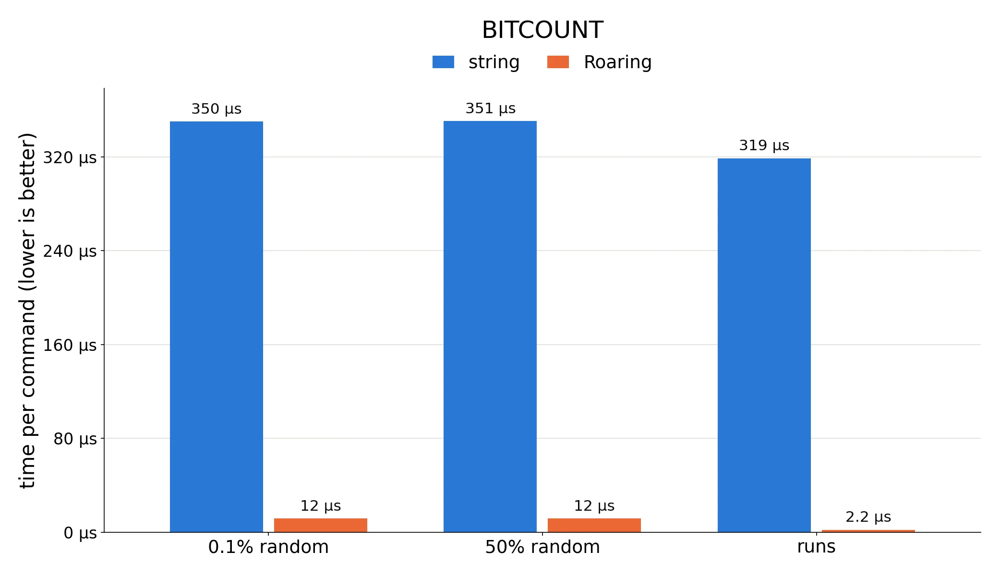
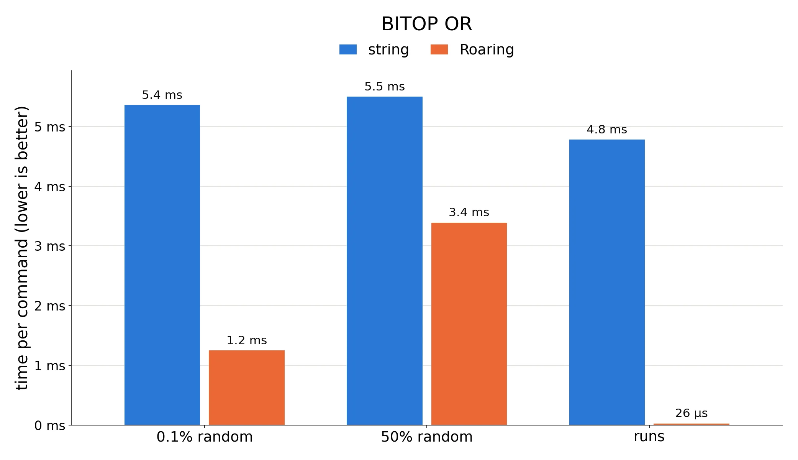
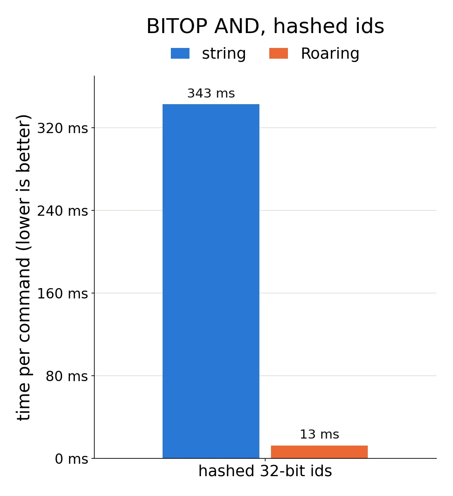

# Redis now has compressed bitmaps (Roaring)

<!-- Benchmark: bench.py; results in results_big4.{md,json}; charts: plot.py.
     Redis unstable at f3b9b68 (the merge commit), GCC 14.3, -O3, jemalloc.
     Intel Xeon Gold 6548N (Emerald Rapids), server pinned to one core. -->

[Redis](https://redis.io) is an in-memory database. Salvatore Sanfilippo
started it in 2009, and it is now one of the most widely deployed pieces of
server software. It is often used as a cache in front of a slower database,
but also as a session store, a message queue or a leaderboard. You talk to it
over the network with short text commands such as `SET user:42 "Alice"` and
`GET user:42`. Each key maps to a value, and the value can be more than a
string: Redis has lists, hashes, sets, sorted sets, streams and more, each
with its own commands. Because everything lives in memory and a single
thread executes the commands one after the other, most commands complete in
microseconds.

Redis has supported bitmaps for a long time. You call `SETBIT key offset 1`,
and Redis stores a plain bitset inside an ordinary Redis string: bit *i* of
the bitmap is bit *i* of the string. It is simple and fast. But the string
takes one byte per eight bit positions, up to the largest offset you ever set,
however many bits are actually set. Setting a single bit at offset four
billion allocates 512 MB, and every `BITCOUNT` or `BITOP` has to scan all of
it.

A compressed bitmap avoids this cost: it stores a set of integers in a form
that takes little room when the set is sparse, and it computes counts,
intersections and unions without decompressing. [Roaring](https://roaringbitmap.org)
is probably the most widely used compressed bitmap format. Rather than
compressing a long string of bits, Roaring adapts its storage to the data:
sparse regions are stored as short lists of integers, dense regions as plain
bitsets, and long stretches of consecutive values as runs. It is often both
smaller and faster than an uncompressed bitset. Roaring is used by
[many systems you already know](https://roaringbitmap.org): Apache Lucene and
Elasticsearch, Apache Spark, Apache Druid, Apache Pinot, Apache Hive,
ClickHouse, StarRocks, InfluxDB, Netflix Atlas and Google Procella, the SQL
engine behind YouTube.

Antonio Viggiano has brought Roaring into Redis itself. His pull request
([redis/redis#15331](https://github.com/redis/redis/pull/15331)), merged on
October 14, 2026, adds a native Roaring bitmap. It should ship in Redis 8.12.

- There is a new type: `TYPE key` returns `bitmap` and `OBJECT ENCODING key`
  returns `bitmap-roaring`.
- It is opt-in: `CONFIG SET bitmap-default-roaring yes`.
- It is not a drop-in replacement. `GET` and the other string commands
  return `WRONGTYPE`.

I built Redis at the merge commit and ran the server on one core of an Intel
Xeon Gold 6548N. For each workload, I create two bitmaps, `a` and `b`, once as
strings and once as Roaring bitmaps, with the same content, and I time the
commands. The times are server-side (from `INFO commandstats`), so they
exclude the network and the client. My workloads:

- *0.1% random*: 100,000 random ids out of 100 million (think: the users who
  used a given feature today);
- *50% random*: 50 million random ids out of 100 million;
- *runs*: ten runs of one million consecutive ids in a range of 100 million
  (think: cohorts of users who signed up in the same week);
- *hashed 32-bit ids*: 100,000 random 32-bit values, so the string is 512 MB.

The hashed ids are a different story. The string must span all four billion
bit positions, and each `BITOP` scans 512 MB. I put them on a separate chart
because they would dwarf the others.

Compressed bitmaps like Roaring are not always better. There are many
tradeoffs. But turning them on will soon take one configuration setting.
