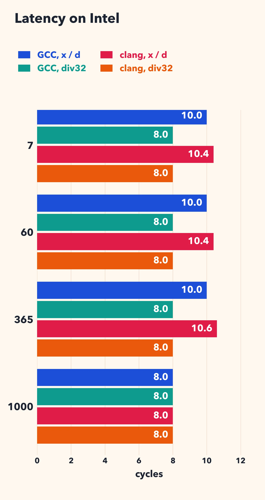
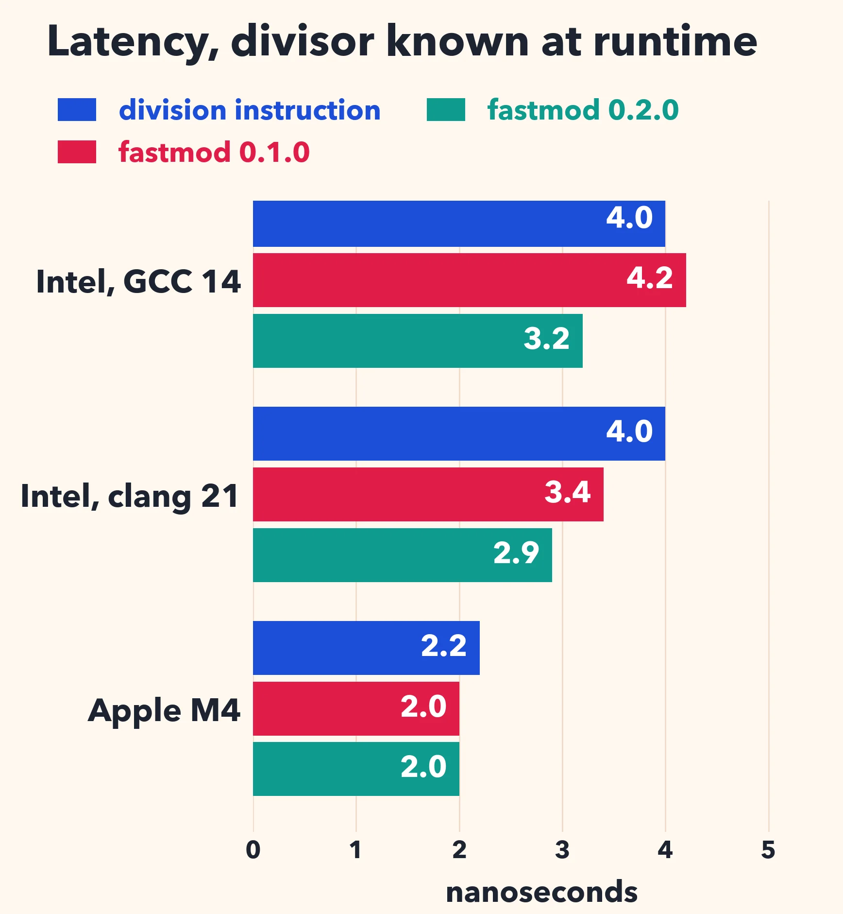

# Beating the compiler at signed 32-bit division

Dividing integers is slow on our processors. A 32-bit division costs:

| processor | latency | throughput |
| --- | --- | --- |
| Emerald Rapids | about 12 cycles | one every 6 cycles |
| Zen 4 | 9 to 12 cycles | one every 6 cycles |
| Zen 5 | 10 to 13 cycles | one every 6 cycles |
| Arrow Lake performance core | 12 cycles | one every 6 cycles |
| Apple M4 performance core | 7 cycles | one every 2 cycles |

On Zen 4 and Zen 5, the latency depends on the inputs. The x86 rows are `idiv` ([uops.info](https://uops.info/html-instr/IDIV_R32.html)). The Apple row is `sdiv` ([measurements](https://jia.je/hardware/2025/05/21/apple-m4/)).

A multiplication has a latency of 3 cycles. Emerald Rapids can do one every cycle. Zen 5 and Arrow Lake do three 64-bit multiplications per cycle ([uops.info](https://uops.info/html-instr/IMUL_R64_R64.html)). 

Thankfully, when the divisor is a constant, compilers replace the division by a multiplication and a shift (Granlund and Montgomery, 1994). Dividing by 7 is like multiplying by 1/7. In integer arithmetic, we multiply by an integer `c` close to `2^s / 7` and we divide by `2^s` with a shift.

Can we do better than the compiler? With signed 32-bit integers on a 64-bit system, often yes.

## The compiler's approach

Let us divide a signed 32-bit integer by 7:

```cpp
int32_t div7(int32_t x) { return x / 7; }
```

GCC 14 produces the following code on an x64 processor:

```asm
	movsx	rax, edi
	imul	rax, rax, -1840700269
	shr	rax, 32
	add	eax, edi
	sar	edi, 31
	sar	eax, 2
	sub	eax, edi
	ret
```

It multiplies by a 32-bit constant, keeps the most significant 32 bits, and adds `x` back (`add eax, edi`). Then it shifts. The instructions `sar edi, 31` and `sub eax, edi` add one when `x` is negative, so that the result is rounded toward zero, as C requires.

Why add `x` back? The ideal multiplier for 7 is 2454267027 which needs 33 bits. It does not fit in a signed 32-bit integer. So the compiler stores `2454267027 - 2^32 = -1840700269` and it corrects the result by adding `x`. This is not rare: among the divisors between 3 and 1000 (excluding powers of two), 38% require this correction (376 out of 990). Over that range, GCC and LLVM pick the same multipliers, following *Hacker's Delight*, Henry S. Warren, Jr.'s book of small algorithms for integers and bits.

## A 33-bit multiplier

But we are on a 64-bit processor! Multiplying a 32-bit integer by a 33-bit integer gives at most a 65-bit integer… but not with *signed* integers. The absolute value of a signed 32-bit integer is at most `2^31`. Our multiplier needs 33 bits as a signed integer, but it is less than `2^32`: it fits in 32 bits as an unsigned integer. So the absolute value of the product is less than `2^63`, and it fits in a signed 64-bit integer.

We need to pick the multiplier. In a paper with Colin Bartlett and Owen Kaser ([Integer division by constants: optimal bounds](https://arxiv.org/abs/2012.12369)), we show (Theorem 1) that `floor(c * n / m) = floor(n / d)` for all integers `n` in `[0, N]` if and only if

`1/d <= c/m < (1 + 1/(N - (N + 1) mod d)) * 1/d`.

We pick `m = 2^s`, the smallest power of two such that `m >= d * 2^31`, and we round up: `c = ceiling(m / d)`. Then `c * d - m < d` and both inequalities hold for `N = 2^31`. We get `floor(|x| / d)` for all signed 32-bit integers `x`. For negative values of `x`, we compute `floor(c * x / m)` and add one, as the compiler does. It works because `c * |x| / m` is never an integer when `x` is not zero: if it were an integer `k`, the bounds would force `|x| = k * d`, and thus `c * d = m`, which is impossible since `d` is not a power of two.

The code is short:

```cpp
template <int32_t d> int32_t div32(int32_t x) {
  constexpr int s = 31 + std::bit_width(uint32_t(d - 1)); // 31 + ceiling(log2(d))
  constexpr int64_t c = (int64_t(1) << s) / d + 1;        // ceiling(2^s / d)
  // floor(c * x / 2^s), plus one when x is negative
  return int32_t((int64_t(x) * c) >> s) - (x >> 31);
}
```

I assume that the divisor is positive and not a power of two. 

GCC 14 compiles `div32<7>` to:

```asm
	movsx	rax, edi
	mov	edx, 2454267027
	shr	edi, 31
	imul	rax, rdx
	sar	rax, 34
	add	eax, edi
	ret
```

There is no correction step after the multiplication. The longest chain of dependent instructions is now `movsx`, `imul`, `sar`, `add` instead of `movsx`, `imul`, `shr`, `add`, `sar`, `sub`. The constant fits in 32 bits as an *unsigned* value, so loading it is cheap.

On ARM (Apple M4), the compiler gives us:

```asm
_compiler_div7:
	mov	w8, #9363
	movk	w8, #37449, lsl #16
	smull	x8, w0, w8
	lsr	x8, x8, #32
	add	w8, w8, w0
	asr	w9, w8, #2
	add	w0, w9, w8, lsr #31
	ret
```

and the new approach gives us:

```asm
_div32_7:
	sxtw	x8, w0
	mov	w9, #9363
	movk	w9, #37449, lsl #16
	mul	x8, x8, x9
	asr	x8, x8, #34
	add	w0, w8, w0, lsr #31
	ret
```

Why don't compilers do it? I don't know. 

## Performance

I divide 16384 random signed integers. In the *throughput* test, the divisions are independent. In the *latency* test, each division depends on the previous one. The latency includes two cycles of overhead (to make each division depend on the previous one). I disable autovectorization. I use an Intel Xeon Gold 6548N (Emerald Rapids) with GCC 14 and clang 21, and an Apple M4 Max with Apple clang 17.

*Intel, cycles per division: throughput (latency)*



| divisor | GCC: x / d | GCC: div32 | clang: x / d | clang: div32 |
| ------: | ---------: | ---------: | -----------: | -----------: |
| 7       | 2.0 (10.0) | 2.0 (8.0)  | 1.76 (10.4)  | 1.38 (8.0)   |
| 60      | 2.0 (10.0) | 2.0 (8.0)  | 1.76 (10.4)  | 1.38 (8.0)   |
| 365     | 2.0 (10.0) | 2.0 (8.0)  | 1.76 (10.6)  | 1.38 (8.0)   |
| 1000    | 2.0 (8.0)  | 2.0 (8.0)  | 1.35 (8.0)   | 1.38 (8.0)   |

*Apple M4, nanoseconds per division: throughput (latency)*

| divisor | x / d        | div32        |
| ------: | -----------: | -----------: |
| 7       | 0.34 (2.01)  | 0.29 (1.77)  |
| 60      | 0.31 (2.00)  | 0.27 (1.77)  |
| 365     | 0.34 (2.00)  | 0.28 (1.77)  |
| 1000    | 0.29 (1.57)  | 0.27 (1.77)  |

For 7, 60 and 365, the latency goes down by 2 cycles with GCC (10 to 8), and from 10.4 or 10.6 to 8 with clang. On the M4 it goes down by 12%. With clang on the Intel processor, the throughput improves by more than 20%. With GCC, the throughput does not change in my benchmark.

The divisor 1000 is a control. The compiler's multiplier is 274877907, which fits in a signed 32-bit register, so there is nothing to add back. On the Intel processor both versions take 8 cycles. Each one starts with `movsx`, then a multiplication, a shift, and an add or a subtract.

On the M4, `div32` is slightly slower: 1.77 ns against 1.57 ns. The compiler's multiplier fits in a signed 32-bit register, so it uses `smull`, which sign-extends `x` as part of the multiplication. Our multiplier (2199023256) does not fit in a signed 32-bit register, so we need a separate `sxtw` instruction before the multiplication. Thus you should only use `div32` when the compiler needs the correction step.

## When the divisor is not a constant

When the divisor is only known at runtime, the compiler cannot help and it emits the division instruction. Years ago, I wrote a small library, [fastmod](https://github.com/lemire/fastmod), that precomputes a 64-bit multiplier `M`, about `2^64 / |d|`, once, and then divides with a multiplication. It is described in [Faster Remainder by Direct Computation](https://arxiv.org/abs/1902.01961) (Software: Practice and Experience, 2019).

Its signed division function treated `M` as an unsigned integer. Multiplying an unsigned 64-bit integer by a signed integer requires a correction when the signed integer is negative. The 0.1.0 code branches on the sign of `x`. On x64 the compiler leaves the branch in place. With random signs, it is often mispredicted: in my tests, that happens in 36% to 48% of the divisions.

The same observation applies: the absolute value of `x` is at most `2^31`, and as long as `|d| > 2`, `M` is less than `2^63`. So a *signed* 64-bit multiplication gives the right answer directly. When `|d| = 2`, we add `x` back. The new function has no branch:

```c
int32_t fastdiv_s32(int32_t a, uint64_t M, int32_t d) {
  int64_t signed_M = (int64_t)M;
  int64_t highbits = mul128_s64_hi(a, signed_M) + (a & (signed_M >> 63));
  // Round toward zero: add one when a < 0.
  int32_t q = (int32_t)highbits + (a < 0 ? 1 : 0);
  // Negate when d < 0.
  int32_t sign_d = d >> 31;
  return (q ^ sign_d) - sign_d;
}
```

The function `mul128_s64_hi` returns the most significant 64 bits of the 128-bit product of two signed 64-bit integers: it compiles to a single instruction (`imul` on x64, `smulh` on ARM). The value `signed_M >> 63` is zero unless `|d| = 2`; it only depends on the divisor, so the compiler can compute it once, outside the loop. I released this change as [fastmod 0.2.0](https://github.com/lemire/fastmod/releases/tag/v0.2.0).

Here are the results for a divisor (7) passed on the command line, with random signs. I report the time per division in nanoseconds: throughput (latency).

| system           | division instruction | fastmod 0.1.0 | fastmod 0.2.0 |
| ---------------- | -------------------: | ------------: | ------------: |
| Intel, GCC 14    | 1.72 (4.0)           | 3.07 (4.2)    | 0.77 (3.2)    |
| Intel, clang 21  | 1.72 (4.0)           | 3.42 (3.4)    | 0.78 (2.9)    |
| Apple M4         | 0.44 (2.2)           | 0.39 (2.0)    | 0.38 (2.0)    |



On the Intel processor, the previous version of the library was *slower* than the division instruction with random signs because of the mispredicted branches. The new version is four times faster than the previous one, and more than twice as fast as the division instruction. On the Apple M4, the previous version did not branch (the compiler computed both cases and selected one), so there is little difference in scalar code. However, without the branch, clang can partially vectorize a loop calling the new function: if I allow autovectorization, the new version takes 0.22 ns on the M4.

## Conclusion

When dividing signed 32-bit integers on a 64-bit processor, there is a free bit. Compilers do not use it. For more than a third of the divisors, we can avoid two instructions on the critical path, and in a library that divides by a runtime divisor, we can avoid a branch.

This investigation was prompted by Ben Joffe's recent post on [fast floor division by constants](https://www.benjoffe.com/fast-floordiv), which you should read.

[My source code is available](https://github.com/lemire/Code-used-on-Daniel-Lemire-s-blog/tree/master/2026/10/signeddiv).

**References**

- Daniel Lemire, Colin Bartlett, Owen Kaser, [Integer division by constants: optimal bounds](https://arxiv.org/abs/2012.12369), Heliyon 7 (6), 2021.
- Daniel Lemire, Owen Kaser, Nathan Kurz, [Faster Remainder by Direct Computation: Applications to Compilers and Software Libraries](https://arxiv.org/abs/1902.01961), Software: Practice and Experience 49 (6), 2019.
- Torbjörn Granlund, Peter L. Montgomery, Division by invariant integers using multiplication, PLDI 1994.
- Henry S. Warren, Jr., Hacker's Delight, 2nd edition, 2013.
