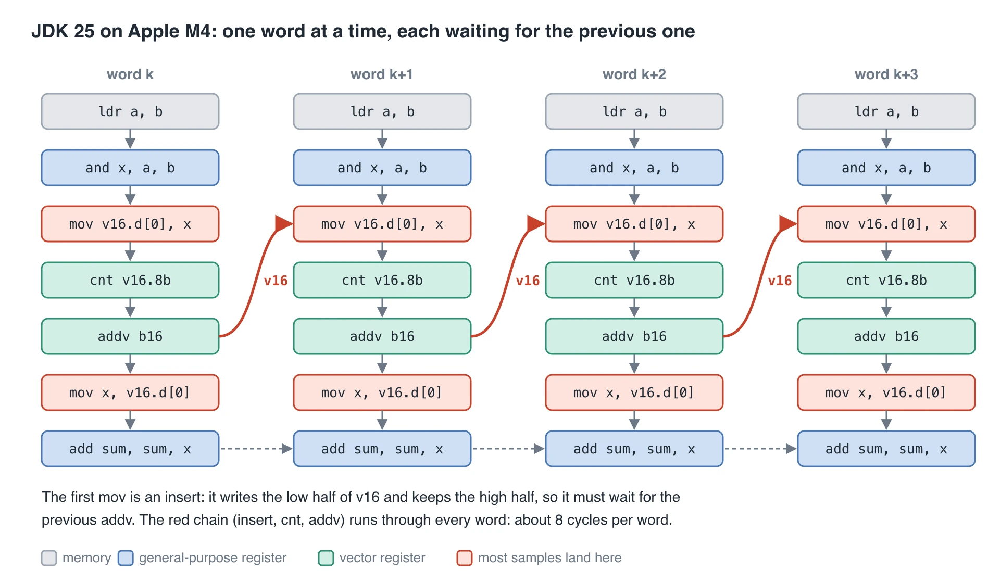
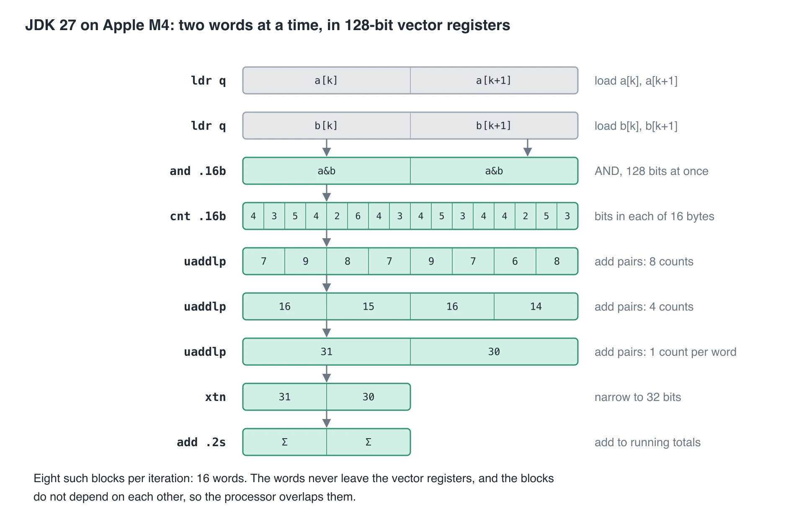
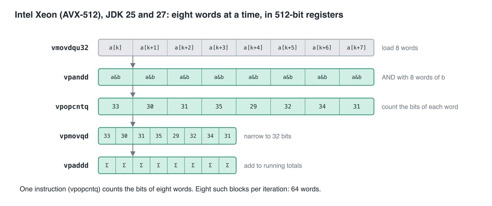

# Seeing the machine code of your Java program, with a few lines of Java

When I want to know why some Java code is slow, I usually reach for JMH. JMH is great to time a function. But a timing tells you *how* slow the code is, not *why*. For that, you need to see the machine code that the JIT compiler produced, and where the processor spends its time in it.

Richard Startin has a new library that does exactly that: [instructive](https://github.com/richardstartin/instructive). Every 10 ms of CPU time, it records which machine instruction is running. At the end, you get the hottest compiled methods and, for each of them, how many samples landed on each instruction. It might be cooler than JMH for this purpose. Let me show you.

## Bitmaps and Roaring

A bitmap is a way to store a set of integers. You use one bit per possible integer: bit *i* is set if *i* is in the set. To intersect two sets, you compute the bitwise AND of the two bitmaps, 64 bits at a time. To count the elements, you count the set bits. Processors are very good at these operations, which is why databases and search engines use bitmaps everywhere: the set of all rows where the country is Canada, the set of all documents containing the word *apple*, and so forth.

A plain bitmap can waste a lot of memory: a set containing only the integer one billion needs a billion bits. [Roaring](https://roaringbitmap.org) solves this problem. It splits the integers into chunks of 65536 values. Within a chunk, a few values are stored as a sorted array, and many values are stored as a plain bitmap: 1024 64-bit words, called a *bitmap container*. Roaring is used by Apache Spark, Apache Hive, Apache Druid, Apache Pinot, Apache Iceberg, Apache Flink, Netflix Atlas, Google Procella (YouTube's SQL engine) and Apache Lucene, among many others. I use the Java library, [RoaringBitmap](https://github.com/RoaringBitmap/RoaringBitmap).

## andCardinality

A common question is: how many elements do two sets have in common? You could compute the intersection and then count its elements, but that creates a new bitmap that you throw away. RoaringBitmap has a function that only counts: `RoaringBitmap.andCardinality`. When both chunks are bitmap containers, it ends up in this loop:

```java
public int andCardinality(final BitmapContainer value2) {
  int newCardinality = 0;
  for (int k = 0; k < this.bitmap.length; ++k) {
    newCardinality += Long.bitCount(this.bitmap[k] & value2.bitmap[k]);
  }
  return newCardinality;
}
```

It is a simple loop: an AND and a population count (`Long.bitCount`) per word. I would expect it to be fast.

## The program

Using instructive is simple:

```java
Sampler.start();
// ... run the workload ...
Sampler.stop();
```

So what is the workload? I need two bitmaps made of bitmap containers. I consider the integers from 0 to 4,194,303: that is 64 chunks of 65536 integers. For each integer, I flip a coin, and I add the integer to the set if I get heads:

```java
static RoaringBitmap dense(long seed) {
    Random r = new Random(seed);
    RoaringBitmap b = new RoaringBitmap();
    for (int i = 0; i < 64 * 65536; i++) {
        if (r.nextBoolean()) {
            b.add(i);
        }
    }
    return b;
}
```

Each chunk then contains about 32,768 integers, half of all possible values, so Roaring stores each chunk as a bitmap container. Counting the common elements of two such sets means going through 64 × 1024 = 65,536 words.

Java does not compile your code to machine code right away. It first interprets it, and it compiles a method with its optimizing compiler (C2) only after the method has been called many times. If I sampled from the start, I would mostly see the interpreter. So I first call `andCardinality` 10,000 times, to get the optimized machine code. Then I call it 100,000 times while the sampler runs, and I print the hottest method:

```java
RoaringBitmap a = dense(1), b = dense(2);
long sink = 0;
for (int i = 0; i < 10_000; i++) {
    sink += RoaringBitmap.andCardinality(a, b); // warm up
}
Sampler.start();
for (int i = 0; i < 100_000; i++) {
    sink += RoaringBitmap.andCardinality(a, b);
}
Sampler.stop();
InstructionProfileFormatter formatter = new InstructionProfileFormatter();
Sampler.forEachHottestMethod(1, profile -> formatter.format(profile.snapshot(), System.out));
```

That is all. It is an ordinary Java program: you add the instructive jar with `-javaagent` and you run it.

## What I found on an Apple M4

I used an Apple M4 Max with JDK 25, the current long-term-support release. Each call takes 115 µs. That is 1.75 ns per 64-bit word, or about 8 cycles per word for an AND and a population count. That is slow.

Here is part of what instructive printed (it lists only the instructions that got samples). The disassembler does not yet decode ARM vector instructions, so they appear as `.word`. I added what they are in comments.

```
org.roaringbitmap.RoaringBitmap.andCardinality(...)
  tier 4 (C2), compile id 415, 1528 bytes at 0x00000001158b6180, 1042 samples

  pc                  bytes        instruction                count
  ...
  0x00000001158b6348  50 1c 08 4e  .word 0x4e081c50              48   // mov v16.d[0], x2
  0x00000001158b6354  0b 3e 08 4e  .word 0x4e083e0b              13   // mov x11, v16.d[0]
  0x00000001158b6358  7b 27 40 f9  ldr x27, [x27, #0x48]          6
  0x00000001158b635c  d6 26 40 f9  ldr x22, [x22, #0x48]         19
  0x00000001158b6360  d6 02 1b 8a  and x22, x22, x27              1
  0x00000001158b6364  d0 1e 08 4e  .word 0x4e081ed0              48   // mov v16.d[0], x22
  0x00000001158b6368  10 5a 20 0e  .word 0x0e205a10               8   // cnt v16.8b, v16.8b
  0x00000001158b636c  10 ba 31 0e  .word 0x0e31ba10               9   // addv b16, v16.8b
  0x00000001158b6370  10 3e 08 4e  .word 0x4e083e10             182   // mov x16, v16.d[0]
```

ARM processors have no instruction to count the bits of a regular 64-bit register (at least not before the recent CSSC extension). So Java does it in four steps: copy the word to a vector register, count the bits of each byte (`cnt`), add the byte counts (`addv`), and copy the result back. About 80% of the samples land on the two copies.

The copies themselves are cheap. The problem is subtle. Every population count uses the same register, `v16`, and the first copy is an *insert*: it writes the low half of the 128-bit register and keeps the high half. So it must wait for the previous value of `v16`, that is, for the previous population count. The processor cannot work on several words at once: each word waits for the previous one. You can verify it in C with inline assembly: with an instruction that writes the whole register (`fmov`), the same sequence is six times faster.



With JDK 27, each call takes 15.6 µs, seven times faster. Here is an excerpt of its profile:

```
  0x00000001482e9058  f4 22 c0 3d  ldr q20, [x23, #0x80]         10
  0x00000001482e9064  91 22 c0 3d  ldr q17, [x20, #0x80]          9
  0x00000001482e9080  70 86 b0 0e  .word 0x0eb08670              17   // add v16.2s, v19.2s, v16.2s
  ...
  0x00000001482e909c  31 5a 20 4e  .word 0x4e205a31              10   // cnt v17.16b, v17.16b
```

JDK 27 vectorizes the loop. It loads two words at a time into vector registers (`ldr q`), computes the AND and counts the bits there, and never copies the words back and forth. So upgrading Java makes this function seven times faster on ARM. But only because the loop is vectorized. The code that JDK 27 generates for `Long.bitCount` itself has not changed, and when the compiler cannot vectorize the loop, it is just as slow as with JDK 25.



## What I found on an Intel Xeon

I ran the same program on an Intel Xeon Gold 6548N (Emerald Rapids), pinned to one core. This processor supports AVX-512, including an instruction that counts the bits of eight 64-bit words at once (`vpopcntq`). Does Java use it?

It does, with both JDK 25 and JDK 27 (Temurin 25.0.5 and 27.0.1.1). Each call takes 10 µs, or 0.15 ns per word: faster than the Apple M4 with either version of Java. On x86, instructive decodes the vector instructions too. Here is an excerpt of the profile with JDK 25:

```
  pc                  bytes                             instruction                                       count
  ...
  0x00007fdda7ee9d3d  62 b1 7e 48 6f 8c da d0 01 00 00  vmovdqu32 zmm1, zmmword ptr [rdx + 8*r11 + 0x1d0]      5
  0x00007fdda7ee9d48  62 b1 75 48 db 8c d9 d0 01 00 00  vpandd zmm1, zmm1, zmmword ptr [rcx + 8*r11 + 0x1d0]   3
  0x00007fdda7ee9d53  62 f2 fd 48 55 c0                 vpopcntq zmm0, zmm0                                   2
  0x00007fdda7ee9d5f  62 f2 7e 48 35 c0                 vpmovqd ymm0, zmm0                                    1
  0x00007fdda7ee9d65  c5 fd fe c2                       vpaddd ymm0, ymm0, ymm2                               1
  ...
  0x00007fdda7ee9dd3  41 8d 5b 40                       lea ebx, [r11 + 0x40]                                 6
```

The loop loads eight words at a time into 512-bit registers (`vmovdqu32`), computes the AND (`vpandd`), counts the bits of each of the eight words in one instruction (`vpopcntq`), narrows the eight counts to 32 bits (`vpmovqd`), and adds them to a running total (`vpaddd`). It does this eight times per iteration, so each iteration handles 64 words (`lea ebx, [r11 + 0x40]`).



## Why not JMH?

JMH can show you the same thing with its `perfasm` profiler. But you need to write your benchmark as a JMH project, with its annotations and its build. You need the `hsdis` disassembler, which you must build or find for your JDK, and you need a system profiler: `perf` on Linux, or DTrace with root privileges on macOS (`dtraceasm`).

With instructive, I added three lines to an ordinary Java program. No root, no external tool, no separate project. And because it runs inside the program, you could use it in your actual application, on your actual data, rather than in a benchmark. The profile is a Java object: you can sort it, filter it, or analyze it however you like. instructive even comes with rules that analyze the machine code and report problems such as long dependency chains and loops that were not unrolled.

My benchmark code is [available](https://github.com/lemire/Code-used-on-Daniel-Lemire-s-blog/tree/master/2026/11/instructive).
