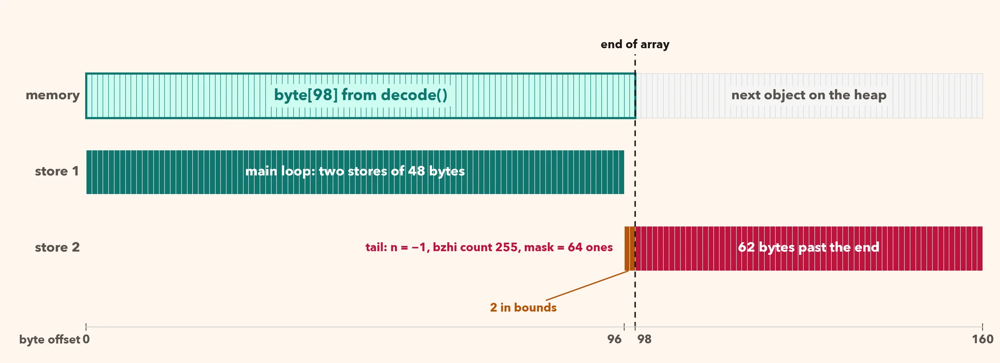

# Java4Shell: when base64 decoding leads to remote code execution?

Let us start with an example that triggers the issue.

```java
byte[] src = ("A".repeat(128) + "=").getBytes(StandardCharsets.US_ASCII);
Base64.getDecoder().decode(src);
```

One hundred and twenty-eight letters A and one `=`. The string is not valid base64, and a correct decoder rejects it. OpenJDK writes past the end of the array anyway. The bug is CVE-2026-114938. It has been in the JDK since 17.0.6. The bad write is in hand-written assembly.

There are claims that it leads to a major security vulnerability. I have not checked. But I care about the issue because I am indirectly involved.

Base64 turns three bytes into four ASCII characters. Email attachments are base64, and a string often ends with `=`. Java sizes the output before it checks the input. One trailing `=` counts as one byte of padding, so the allocated length is

3 × ((129 + 3) / 4) − 1 = 98.

So `decode` allocates 98 bytes, then calls the decoding routine.

On an x86-64 machine with AVX-512 VBMI, the routine takes the first 128 characters as two blocks and writes 96 bytes. That loop follows the algorithm from Muła & Lemire (2020). The character `A` is the value 0, so each block becomes 48 zero bytes. The store is masked to 48 bytes. Both stay inside the array.

One character is left, the `=`. The tail asks how many output bytes a remainder of that length should produce. In integer arithmetic,

(1 / 4) × 3 = 0.

The last character is `=`, so it subtracts one. The length is now −1. A second `=` would subtract again. There is only one.

The tail writes with an AVX-512 masked store. A masked store writes a byte only when the matching bit in a mask is set. See my article [Modern vector programming with masked loads and stores](https://lemire.me/blog/2022/11/08/modern-vector-programming-with-masked-loads-and-stores/). The mask comes from `bzhi`, which keeps the low *n* bits of a word of ones. The count it reads is the low 8 bits of *n*. The low 8 bits of −1 are 255. A count of 255 is past 64, and `bzhi` then clears nothing: every bit stays set, and the store writes the whole 64-byte register.

The store starts where the main loop stopped, at offset 96. The array ends at offset 97. Two bytes land in the array. The other 62, offsets 98 through 159, land past the end.



The function then returns. Java sees a `=` with no data character in the current group and throws `IllegalArgumentException`, with the message “Input byte array has wrong 4-byte ending unit”. The write has already happened.

Java is somewhat behind. The fast decoder stops at a space or a line break. Email wraps every 76 characters, and PEM every 64, so the fast path ends at the first line.

The algorithm in Lemire (2027) removes the ignorable characters inside the vector loop. A clean block of 64 characters is decoded directly. A block that contains whitespace is compacted, and the alphabet characters are decoded from a small buffer. Since the middle of 2025 that decoder has shipped in Safari and in the Chromium browsers (Chrome, Edge, Brave), and in Node.js 25, Deno and Bun. I have a [pull request](https://github.com/php/php-src/pull/25476) that ports the same decoders to PHP. Decoding a 64 KiB MIME input is 30 times faster on an Intel Xeon Gold 6548N, and 39 times faster on an AMD EPYC 9R45.

## References

Muła, W., & Lemire, D. (2020). [Base64 encoding and decoding at almost the speed of a memory copy](https://doi.org/10.1002/spe.2777). Software: Practice and Experience, 50(2), 89–97. ([arXiv](https://arxiv.org/abs/1910.05109))

Lemire, D. (2027). [Fast forgiving base64 decoding with SIMD instructions](https://doi.org/10.1145/3859286). ACM Transactions on Architecture and Code Optimization, 24(1). ([arXiv](https://arxiv.org/abs/2610.17406))
