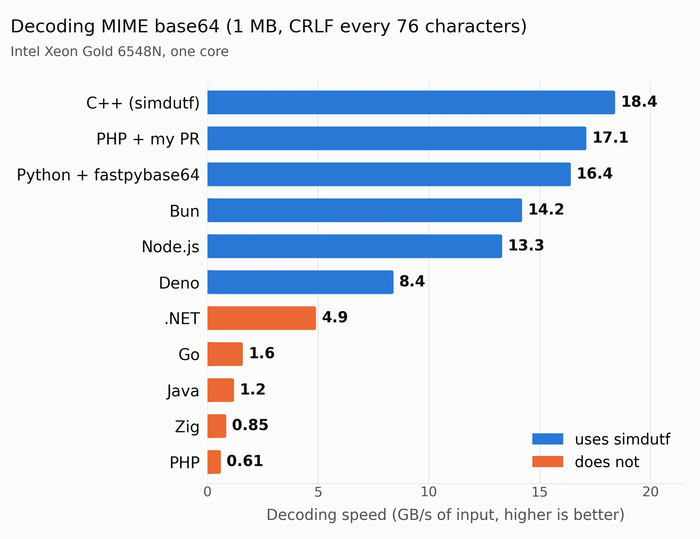

# Decoding base64 email attachments: a speed ranking of programming languages

Email attachments are base64. So are PEM certificates. In both cases the text is broken into lines, 76 characters for email and 64 for PEM, then a carriage return and a line feed. A decoder must skip these line endings. The email form is often called MIME base64.

Skipping line endings sounds trivial. Yet many fast decoders only work on uninterrupted base64. As soon as they meet a line break, they fall back to a slow path.

How fast can we decode MIME base64 in popular programming languages? I wrote a small benchmark. I generate one megabyte of random bytes, encode it as base64 with 76-character lines ending in CRLF (1.37 MB of text) and decode it again with the standard or most popular function of each language. I check that each decoder returns the right bytes.

I use an Intel Xeon Gold 6548N (Emerald Rapids) with Linux, pinned to one core. I report speeds in gigabytes of input per second (GB/s). Each number is the median of three runs, and each run keeps the best of ten timed batches. I use the latest version of each tool.

| rank | system | function | GB/s |
|---:|---|---|---:|
| 1 | C++ (GCC 16) with simdutf 9.4 | `simdutf::base64_to_binary` | 18.4 |
| 2 | PHP 8.7-dev with my pull request | `base64_decode` | 17.1 |
| 3 | Python 3.15 with fastpybase64 | `fastpybase64.b64decode` | 16.4 |
| 4 | Bun 1.4.4 | `Buffer.from(s, 'base64')` | 14.2 |
| 5 | Node.js 26.13 | `Buffer.from(s, 'base64')` | 13.3 |
| 6 | Deno 2.9.8 | `Uint8Array.fromBase64(s)` | 8.4 |
| 7 | .NET 11 | `Base64.DecodeFromUtf8` | 4.9 |
| 8 | Go 1.27.4 | `base64.StdEncoding.Decode` | 1.6 |
| 9 | Java 27 | `Base64.getMimeDecoder().decode` | 1.2 |
| 10 | Zig 0.17.1 | `std.base64` decoder ignoring `\r\n` | 0.85 |
| 11 | PHP 8.5.12 | `base64_decode` | 0.61 |

There is a factor of thirty between the top and the bottom of the table.

The top six systems all rely on the simdutf library. simdutf removes the line endings inside its vector loop. A clean block of 64 characters is decoded directly. A block that contains line endings is compacted first, and decoding proceeds from a small buffer. The line endings never send the decoder to a slow path. See Lemire (2027) for the details.

The same function can run at very different speeds depending on how a system calls it. In JavaScript, `Uint8Array.fromBase64` is slower than `Buffer.from` in both Node.js (8.1 GB/s) and Bun (9.4 GB/s), even though both end up in simdutf. In Node.js, I found that a quarter of the time of `Uint8Array.fromBase64` goes to copying memory and some more to zeroing it. Deno's `Buffer.from` (6.3 GB/s) is slower than its `Uint8Array.fromBase64`.

At the other end, the slow systems use scalar code. Go, Java and Zig decode about one character at a time. Go and Zig at least skip line endings inside their decoding loop. Java does not: its fast decoder stops at the first line ending, and its MIME decoder skips line endings in plain Java code. .NET handles line endings better than these, but it is still about four times slower than simdutf.

PHP is the most dramatic case. With the current release, PHP is last at 0.61 GB/s, even though it decodes base64 without line endings at more than 20 GB/s on this machine. My [pull request](https://github.com/php/php-src/pull/25476) ports the simdutf decoders to PHP. It makes MIME decoding 28 times faster, and PHP moves to second place.

In Python, [fastpybase64](https://github.com/simdutf/fastpybase64), a binding to simdutf, reaches 16.4 GB/s. Getting there took one more fix. fastpybase64 first allocates room for the largest possible output, which counts the line endings as data, then shrinks the result. On Linux, shrinking a large block trapped the glibc allocator into requesting fresh memory from the operating system on every call. The decoder spent most of its time in page faults and ran at 4.3 GB/s. The next release of fastpybase64 keeps the slightly oversized allocation instead.

## Why is Bun faster than Node.js?

Bun and Node.js both call simdutf. Yet Bun is ahead, and the gap grows when we measure differently.

In my benchmark, the difference is small (14.2 GB/s against 13.3 GB/s). It comes mostly from the version of simdutf. Node.js gets simdutf through its copy of the V8 engine, which bundles simdutf 7.7. Bun gets simdutf 9.0 through WebKit. When I rebuilt Node.js with simdutf 9.4 and changed nothing else, it matched Bun.

The gap is larger in a long loop. My benchmark keeps the best of ten short batches, which tends to skip the batches where the garbage collector runs. If I instead time 3000 consecutive calls, Node.js falls to about 8.4 GB/s while Bun stays at 14 GB/s. Decoding into a buffer that is reused, the two runtimes are close (15.4 and 16 to 17.7 GB/s). So the difference comes from allocating a new one-megabyte result on every call.

Two things hurt Node.js. First, V8 reclaims these buffers late. During the loop, Node.js uses up to 185 MB of memory against 49 MB for Bun. Each new buffer is cold: it lies outside the processor's caches, so writing the output costs more. Second, when V8 finally frees a batch of buffers, the glibc allocator returns much of the memory to the operating system, and the next buffers must be faulted back in. Bun's allocator keeps its memory. If I force Node.js to collect garbage every few calls and tell glibc to keep its memory, Node.js matches or beats Bun.

## Conclusion

Line endings in base64 should cost almost nothing. With a modern decoder, they do: simdutf decodes MIME base64 at 18 GB/s, close to its speed on uninterrupted base64. Yet in Java, Go, Zig, and in PHP as shipped today, decoding an email attachment is ten to thirty times slower than it could be. In .NET, it is about four times slower.

[My source code is available](https://github.com/lemire/Code-used-on-Daniel-Lemire-s-blog/tree/master/2026/11/javashell/mimebench).

## References

Lemire, D. (2027). [Fast forgiving base64 decoding with SIMD instructions](https://doi.org/10.1145/3859286). ACM Transactions on Architecture and Code Optimization, 24(1). ([arXiv](https://arxiv.org/abs/2610.17406))

Muła, W., & Lemire, D. (2020). [Base64 encoding and decoding at almost the speed of a memory copy](https://doi.org/10.1002/spe.2777). Software: Practice and Experience, 50(2), 89–97. ([arXiv](https://arxiv.org/abs/1910.05109))
