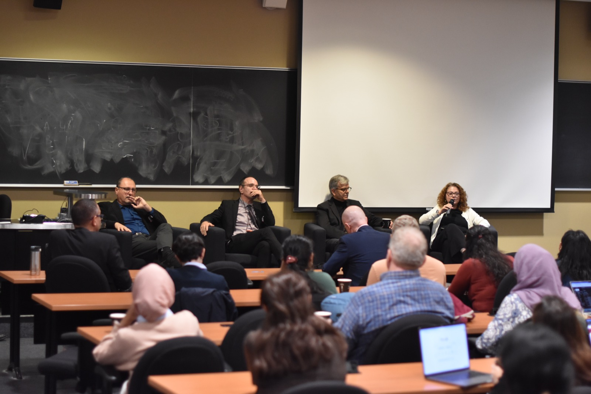

# Open source as a research method

Many people still picture innovation as a line. The professor thinks and publishes. The engineer reads the paper and designs a product. The customer consumes it.

It rarely works that way. The industrial revolution was not set off by professors writing papers. It was driven by demand for cheap and better clothing for the masses. Demand came first.

Michael Stonebraker made a related point in "Where We Have Failed" (2018). He argued that the database research community has lost its customer: "there are no 'real world' clients to keep us focused." Without a customer, research drifts.

In 2019, JSON was everywhere, and parsing it was slow, at a few hundred megabytes per second. So we built [simdjson](https://github.com/simdjson/simdjson). Today it parses JSON at gigabytes per second; I measured about 4.8 GB/s on twitter.json on a recent Intel Xeon.

We did not write the paper first. We wrote the code, then a blog post. We put it on GitHub and posted about it on social networks. Industry adopted it. Our first paper was published by the VLDB Journal, but it was more of an advertisement for our ideas and designs than the endpoint of the research.

Fred Brooks wrote that "the scientist builds in order to study; the engineer studies in order to build." In my work, building is how I study.

Once simdjson parsed JSON quickly, a new bottleneck appeared: floating-point numbers. If everything else is fast, converting strings like `3.1416` into binary floats dominates the running time. That led to what is now called the Eisel-Lemire algorithm, which is exact and fast ([Number Parsing at a Gigabyte per Second](https://arxiv.org/abs/2101.11408)). It now sits inside the standard libraries of Rust, Go, .NET and C++ (through [fast_float](https://github.com/fastfloat/fast_float)).

Then came the next bottleneck. Parsing JSON also means validating UTF-8, and security depends on getting that right. We got validation down to less than one instruction per byte. That code broke off into its own library, [simdutf](https://github.com/simdutf/simdutf), which is now used by Node.js, Bun, Deno and web browsers for Unicode validation and transcoding.

I did not plan any of this from a mountaintop. Stonebraker said it well: "my ideas come from two sources: talking to real users with real problems and then trying to solve them." Open source gives me those users. They show up with bug reports, adversarial inputs, exotic hardware and workloads I would never have imagined. Pull requests and code reviews are often a tougher form of peer review than most program committees. Reviewers who depend on your code read it more carefully than referees who skim your paper.

David Patterson, in "How to Build a Bad Research Center" (2014), wrote that for his successful projects, "the early indicators were not papers or awards, but non-researchers trying to use our ideas." I agree.

Is open source still as important now that we have AI? If a model can write the code for you, why bother publishing yours?

What I see points the other way. More people than ever contribute to my projects, and more people than ever use my code and my ideas. AI tools seem to make it easier, not harder, for people to read an unfamiliar codebase, find a problem and send a fix. 

## When I gave this talk...

Last week (October 29, 2026), I was one of four invited speakers at the launch of [SERIQ](https://seriq.ca/), the new *Centre interuniversitaire de recherche en génie logiciel pour la société numérique*. SERIQ continues the SEMTL (Software Engineering at Montreal) meetings that have brought together Montreal software engineering researchers for more than a decade. The new centre is backed by the Université de Montréal, Polytechnique Montréal, McGill University and the École de technologie supérieure, and it aims to cover all of Quebec. About a hundred people came to the Pavillon Jean-Coutu at the Université de Montréal for the [event](https://seriq.ca/en/events/2026-10-29-rentree-seriq/).

The other three guests were:

- [Lionel Briand](https://www.lbriand.info/) (University of Ottawa and Lero, the Research Ireland centre for software at the University of Limerick), who spoke about how AI disrupts software testing strategies, and how it can also help fix them.
- [Marsha Chechik](https://discover.research.utoronto.ca/24922-marsha-chechik) (University of Toronto), who spoke about designing the digital society, from human intent to reliable systems.
- Yves Daoust (Ferme d'Hiver), an engineer who worked in telecommunications before founding a farming company. He looked back on forty years of software, from punched cards to AI agents, and asked why this moment is different.

Each of us had fifteen minutes. Afterwards, the four of us sat down for a panel on software research for society, moderated by Martin Robillard (McGill).

My [slides are online](http://lemire.github.io/talks/2026/seriq/seriq_en.html).