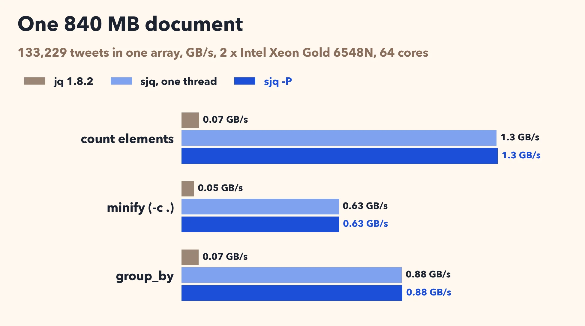

# Command-line JSON filtering at 20 GB/s

If you work with JSON on the command line, you probably use [jq](https://jqlang.org). You give it a filter, a small program in its own language, and it runs that filter on each JSON document.

I generated a file of 1 GB with one tweet per line. That format is called NDJSON, and it is a common way to store logs. The file is `tweets.ndjson`: 230,138 tweets. Shortened, a line looks like this:

```
{"id":505874924095815681,"lang":"ja","retweet_count":0,"user":{"screen_name":"ayuu0123"}}
```

The account name is `screen_name`, inside the `user` object. This prints it for every tweet:

```
jq -r '.user.screen_name' tweets.ndjson
```

The flag `-r` writes the text without quotes, so the output begins `ayuu0123`.

I love jq. Its language is expressive and it is everywhere. But extracting that field with jq 1.8.2 takes 11.5 seconds, less than 0.1 GB/s.

We have a library, [simdjson](https://github.com/simdjson/simdjson), that parses JSON at gigabytes per second. So we built [sjq](https://github.com/simdjson/sjq), a command-line tool that reads the jq language and runs on simdjson. The filters you write for jq work with sjq.

On this same file, with just one thread, sjq takes 0.31 seconds: 3.5 GB/s, about 37 times faster than jq. One thread is the default:

```
sjq -r '.user.screen_name' tweets.ndjson
```

But wait! The sjq command line can also be multithreaded. Add `-P` and sjq starts one worker per available processor, up to 32. The main thread only writes the output, so more threads would not help. The server I used has 64 cores, so sjq takes 32 threads. The same filter then takes 0.05 seconds: 20 GB/s, about 210 times faster than jq.

```
sjq -P -r '.user.screen_name' tweets.ndjson
```

Pass `--threads n` when you want a chosen number of threads, and `--threads 0` to use every processor.


How is that possible? There are three reasons.

1. Parsing JSON is the bulk of the work, and simdjson is a really fast parser.
2. When a filter only navigates and selects, sjq parses only what the filter needs. To get `.user.screen_name`, it does not need to look at the text of the tweet or at its entities.
3. Logs are made of many small documents, one per line. With `-P`, sjq cuts the file in pieces and filters them on several workers. The main thread writes the results in order: the output is the same as with one thread.


A file can also be a single, large document. Then sjq uses one core, but it is still 12 to 18 times faster than jq.



Is sjq really compatible with jq? We took the test suite of jq itself: sjq passes 728 of its 781 tests. The failures are mostly about modules, numbers wider than 64 bits, values nested more than 10,000 levels deep, and the wording of some error messages. The [jq tutorial](https://jqlang.org/tutorial/) runs unchanged. You have function definitions, `reduce` and `foreach`, string interpolation, the `@csv` and `@base64` formats, assignments such as `|=`, regular expressions, dates, `--arg`, `--slurp`, and so forth. There are differences: for example, regular expressions use the syntax of the C++ standard library, and dates are in UTC.

sjq also does something jq does not. JSON written by jq is either compact, on one line, or pretty-printed with one value per line, which can be long to read. With the `--fractured` option, sjq uses the [FracturedJson](https://github.com/j-brooke/FracturedJson) layout instead: short arrays and objects stay on one line, and arrays of similar records become aligned tables.

```
$ sjq --fractured '.statuses[:4] | map({id, lang, rt: .retweet_count, user: .user.screen_name})' twitter.json
[
  {"id": 505874924095815681, "lang": "ja", "rt": 0 , "user": "ayuu0123"   },
  {"id": 505874922023837696, "lang": "ja", "rt": 82, "user": "yuttari1998"},
  {"id": 505874920140591104, "lang": "ja", "rt": 0 , "user": "ttm_protect"},
  {"id": 505874919020699648, "lang": "ja", "rt": 58, "user": "chibu4267"  }
]
```

You can install sjq on Linux and macOS with one command:

```
curl -fsSL https://raw.githubusercontent.com/simdjson/sjq/main/install.sh | sh
```

On Windows, in PowerShell:

```
irm https://raw.githubusercontent.com/simdjson/sjq/main/install.ps1 | iex
```

You can also use Homebrew (macOS and Linux) or Scoop (Windows):

```
brew install simdjson/tap/sjq
scoop bucket add sjq https://github.com/simdjson/sjq
scoop install sjq/sjq
```

The Linux binaries are static, so they run on any distribution. They run on any 64-bit x64 or ARM processor: simdjson detects your processor when sjq starts and picks the fastest code it supports.

sjq is new. If a jq filter does not work, or gives a different result, please [report it](https://github.com/simdjson/sjq/issues).

[My benchmark is available](https://github.com/lemire/Code-used-on-Daniel-Lemire-s-blog/tree/master/2026/11/sjq).
