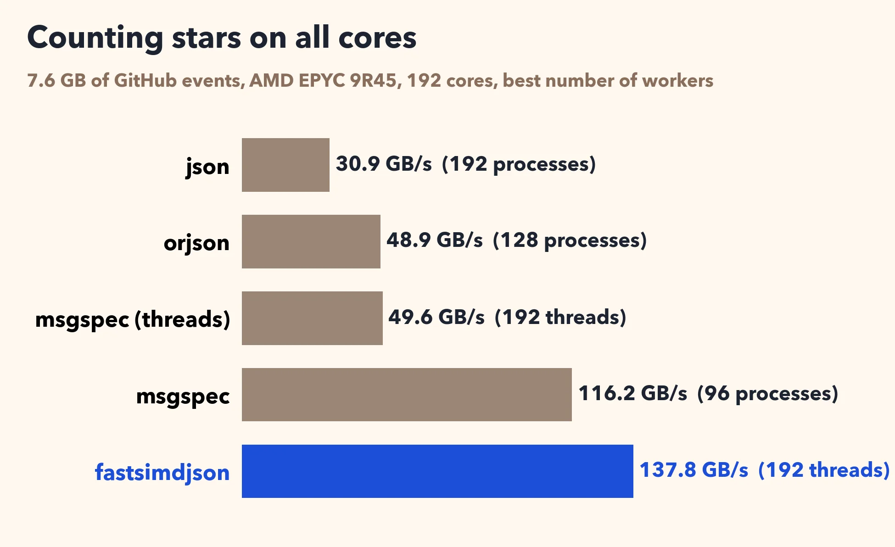
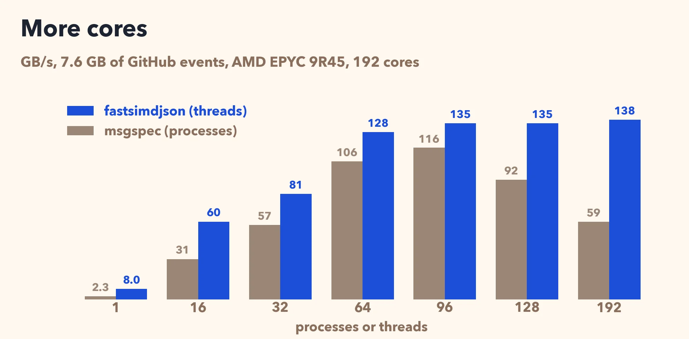
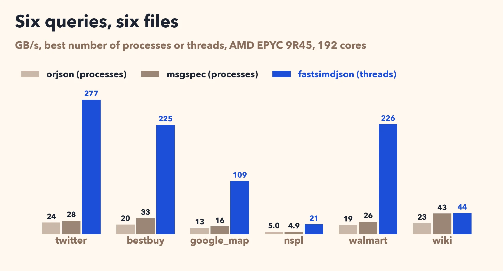

# Reading JSON at 277 GB/s in Python

Many systems log their data as JSON, one record per line (NDJSON). GitHub, for example, publishes every public event on its site that way through [GH Archive](https://www.gharchive.org): about a gigabyte per hour. Suppose you want to know which repositories received the most stars over eight hours. That is 7.6 GB of JSON, 2.2 million events.

In Python, the obvious code reads each line with the `json` module:

```python
for line in open("events.ndjson", "rb"):
    event = json.loads(line)
    if event["type"] == "WatchEvent":
        stars[event["repo"]["name"]] += 1
```

It runs at 0.28 GB/s: 27 seconds for this file. The orjson package is twice as fast. The msgspec package, which decodes only the fields you declare, is eight times as fast.

A server has many cores, but a Python process with the GIL runs Python code on one core at a time. The usual answer is a pool of processes: cut the file in pieces, give a piece to each process, and add up their counts. Each process returns a small table, so little has to come back.

Python 3.14 has a free-threaded build (`python3.14t`) without the GIL: threads run Python code at the same time. The [fastsimdjson](https://github.com/simdjson/fastpysimdjson) library is threaded. You give it the data and a function. It parses the records on many threads, and calls your function on the thread that parsed the record. You name the fields you want. It reads only what leads to them, and your function receives those values, not the whole record.

```python
import collections
import fastsimdjson

def starred(event):
    kind, repo = event
    if kind == "WatchEvent":
        return repo

names = fastsimdjson.map_many(
    starred, data, threads=192,
    fields=["/type", "/repo/name"], drop_none=True)
stars = collections.Counter(names)
```

The variable `data` is the file, mapped in memory. The two paths are the event type and the repository name. The `drop_none` parameter leaves out the records that are not stars.

I ran this on an AWS instance (`c8a.metal-48xl`) with two AMD EPYC 9R45 processors, 192 cores, using Python 3.14.10, orjson 3.13 and msgspec 0.22. The file is mapped before the clock starts. On one core, fastsimdjson reads 8 GB/s, three and a half times as fast as msgspec.


With 192 threads, fastsimdjson counts the stars in the 7.6 GB in 55 milliseconds: 138 GB/s. The best pool of msgspec processes reaches 116 GB/s, at 96 processes. More processes make it slower.



fastsimdjson is ahead at every worker count. The lead shrinks from three and a half times on one core to about 20%.



Counting is the best case for processes, because little comes back. Often you want the values themselves. I took six files of about a gigabyte from an existing benchmark (Pison), and pulled a field or two from every record. On the twitter file, fastsimdjson reaches 277 GB/s. Four of the six files pass 100 GB/s. The other two are slower: one stays near 20 GB/s, still about four times as fast as msgspec, and one is a tie.



[My source code is available](https://github.com/lemire/Code-used-on-Daniel-Lemire-s-blog/tree/master/2026/11/superfastjson).
