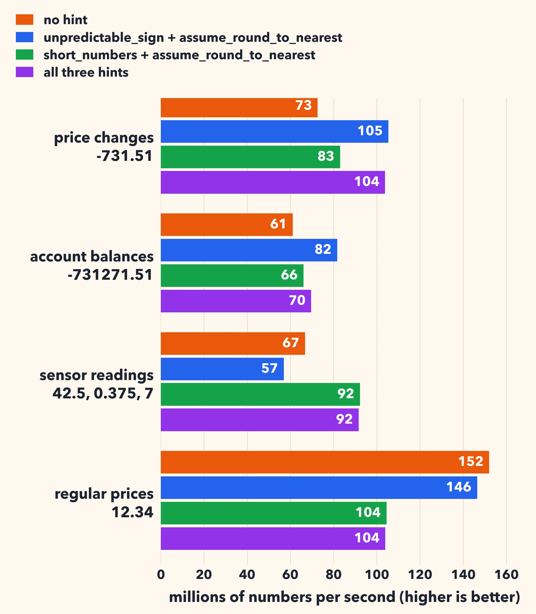
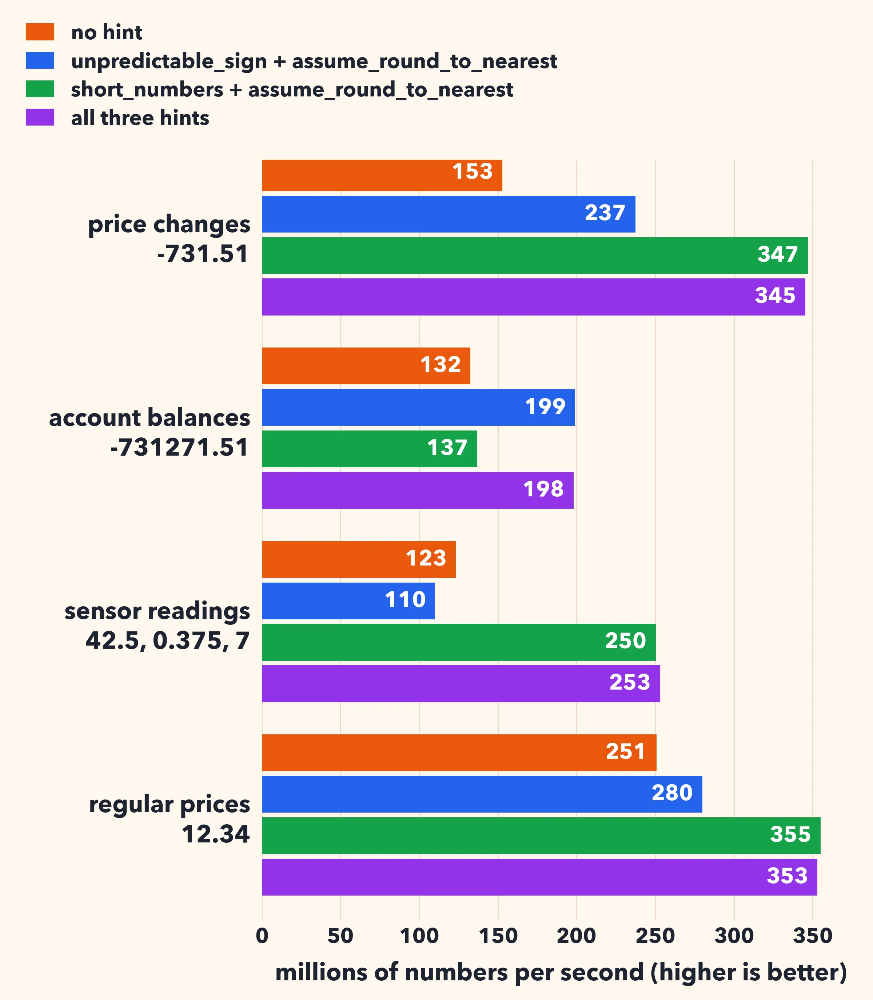

# Telling your number parser what to expect

Our [fast_float](https://github.com/fastfloat/fast_float) library parses numbers such as `-731.51` into binary floating-point values. It is part of GCC's C++ standard library, among others. It is fast: often a few nanoseconds per number.

Parsing a number means making decisions. Is there a sign? How many digits are there? Where is the decimal point? Is the processor rounding in the default mode? Each decision is a branch in the code. Modern processors do not wait to know the outcome of a branch: they guess, and they keep working. When they guess right, the branch is nearly free. When they guess wrong, they throw away the work done since the branch, and that costs 15 to 20 cycles.

When all your numbers look alike, the processor guesses right. When they do not, it guesses wrong often. Consider a column of gains and losses: the sign is random. The processor cannot guess it, and it pays for its mistakes on about half of the numbers.

You often know things about your data that the parser cannot know. So we are adding *performance hints* to fast_float. You pass them as a template argument:

```cpp
using fast_float::performance_hints;
double value;
auto answer = fast_float::from_chars<performance_hints::unpredictable_sign>(
    input.data(), input.data() + input.size(), value);
```

There are three hints, and you may combine them with `|`:

* `unpredictable_sign`: the signs come in random order. The parser then handles the sign without a branch.
* `short_numbers`: each number is given alone (the range holds just the number) and most numbers have at most 8 characters, such as `42.5` or `-3.75`, in varying shapes. The parser then reads all 8 characters at once with a few bitwise operations, without a branch on the number of digits or the position of the decimal point.
* `assume_round_to_nearest`: your program never changes the rounding mode, so the parser does not check it.

The hints never change the results, with one exception. If you promise `assume_round_to_nearest` and some code in your program changes the rounding mode, some results will be wrong.

The hints work with `fast_float::from_chars`, `fast_float::from_chars_advanced` and `fast_float::integer_times_pow10`. Without hints, nothing changes.

How much do they help? I generated four kinds of data, 100,000 numbers each:

* price changes, two decimals and random signs, such as `-731.51` or `42.07`;
* account balances, two decimals and random signs, but longer, such as `-731271.51`;
* sensor readings, all positive, but in varying shapes, such as `7`, `1042`, `42.5` and `0.375`;
* regular prices, always the same shape, such as `12.34`.

I parse them on an Intel Xeon Gold 6338 (Ice Lake) with GCC 15, and on an Apple M4 Max with Apple clang 17. I report millions of numbers parsed per second: higher is better.





Each kind of data has its own best combination.

Price changes have random signs and short numbers. On the Intel processor, adding `unpredictable_sign` and `assume_round_to_nearest` goes from 73 to 105 million numbers per second. All three hints do as well (104 million), and they are best on the Apple processor, going from 153 to 345 million numbers per second: more than twice as fast. Without hints, the Intel processor mispredicts a branch on 60% of the numbers. With all three hints, the mispredictions disappear.

Account balances also have random signs, but the numbers are too long for `short_numbers`. Here `unpredictable_sign` with `assume_round_to_nearest` is the right choice: from 61 to 82 million numbers per second on the Intel processor, and from 132 to 199 million on the Apple processor. Adding `short_numbers` makes things worse on the Intel processor (70 million): the hint does not apply to these numbers, yet we pay for it.

Sensor readings have no sign, but their shapes vary. Here `short_numbers` is the key: from 67 to 92 million numbers per second on the Intel processor, and from 123 to 250 million on the Apple processor. The hint `unpredictable_sign` is harmful: there is no sign to predict, and the branch-free code is more work. On the Intel processor, it goes down to 57 million.

Regular prices are the easy case: all positive, always the same shape. The processor guesses everything right. On the Intel processor, the best choice is no hint at all (152 million numbers per second), and `short_numbers` makes things much slower (104 million). The Apple processor is different: `short_numbers` still helps, from 251 to 355 million numbers per second.

With Clang 21 on the Intel processor, the results are similar: the same hints win on the same data.

So the hints are not free. They trade branches, which are cheap when the processor guesses right, for more instructions. They pay off when the processor would guess wrong.

The hints are currently in a [pull request](https://github.com/fastfloat/fast_float/pull/434).

[My source code is available](https://github.com/lemire/Code-used-on-Daniel-Lemire-s-blog/tree/master/2026/11/tunefastfloat).
